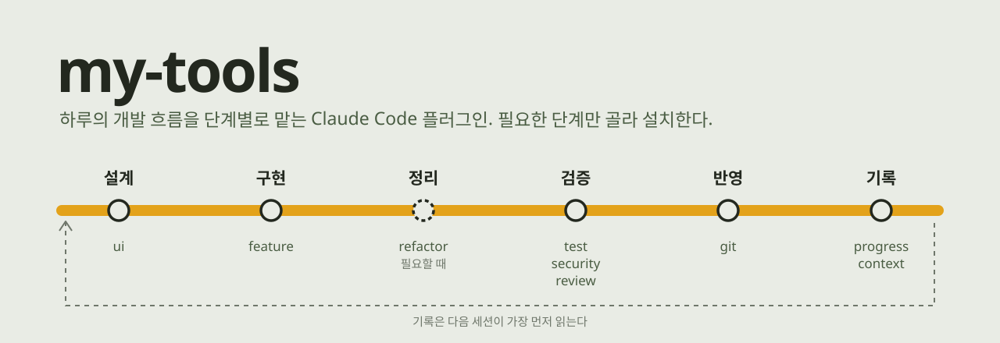

<p align="center">
  
</p>

Claude Code로 개발할 때 매번 같은 지시를 반복하지 않도록, 자주 쓰는 작업 절차를 플러그인으로 묶었습니다. 플러그인은 작업 흐름의 한 단계씩을 맡습니다. 필요한 단계만 골라 설치하면 됩니다.

어느 프로젝트에서나 동작합니다. 실행할 때 그 저장소의 `CLAUDE.md`, `AGENTS.md`, `package.json` 스크립트, 기존 코드를 읽고 검사 명령과 규칙을 정합니다.

## 설치

마켓플레이스를 한 번 등록하고, 원하는 플러그인을 설치합니다.

```
/plugin marketplace add LimjeongSik/my-tools-plugins
/plugin install feature-flow@my-tools
```

Claude Code 2.1.275 이상에서는 한 줄로도 됩니다.

```
/plugin install feature-flow --marketplace LimjeongSik/my-tools-plugins
```

## 단계별 플러그인

| 단계 | 플러그인 | 실행 | 하는 일 |
|---|---|---|---|
| 설계 | [ui-design](plugins/ui-design) | `/ui-design:design` | 화면을 디자인하고, 목업 이미지로 승인받은 뒤 구현합니다 |
| 구현 | [feature-flow](plugins/feature-flow) | `/feature-flow:build` | 기능 구현과 테스트 작성을 서로 다른 에이전트에게 맡깁니다 |
| 정리 | [refactor-sweep](plugins/refactor-sweep) | `/refactor-sweep:sweep` | 리팩터링 지점을 찾고, 동작을 그대로 둔 채 고칩니다 |
| 검증 | [security-audit](plugins/security-audit) | `/security-audit:audit` | 변경분에서 실제로 악용될 수 있는 보안 문제만 찾습니다 |
| 검증 | [codex-triage](plugins/codex-triage) | `/codex-triage:review-apply` | 커밋 전에 Codex 리뷰를 받고, 리뷰를 통과하기 전에는 커밋·푸시를 막습니다 |
| 반영 | [git-workflow](plugins/git-workflow) | `/git-workflow:commit-push` | 검사와 리뷰를 통과한 변경만 나눠서 커밋하고 푸시합니다 |
| 기록 | [docs-progress](plugins/docs-progress) | `/docs-progress:update` | 다음 세션이 읽을 진행 문서를 짧게 유지합니다 |

슬래시 명령 대신 "기능 만들어줘", "리팩토링해줘", "커밋하고 푸시해줘"처럼 말해도 해당 플러그인이 실행됩니다.

### 설계: ui-design

[frontend-design](https://github.com/anthropics/claude-plugins-official) 스킬 위에서 동작하며, 설치할 때 함께 설치됩니다. 레퍼런스 이미지나 URL을 주면 레이아웃, 타이포, 컬러를 분석해서 가져올 것과 베끼지 않을 것을 나눕니다. 대시보드, 모바일 앱, 랜딩 페이지마다 다른 기준으로 디자인합니다.

코드를 쓰기 전에 목업을 PNG로 렌더링해서 보여주고, 승인을 받은 뒤에야 구현합니다. 근거 없는 다크·네이비 테마, 보라 그라데이션, 똑같은 카드 나열은 팔레트 검사와 점검표로 걸러냅니다.

### 구현: feature-flow

구현 에이전트는 테스트를 쓰지 않고, 테스트 에이전트는 소스를 고치지 않습니다. 자기 코드에 맞춰 쓴 테스트는 버그를 잡지 못하기 때문입니다. 테스트에서 소스 버그가 나오면 구현 쪽으로 되돌리며, 이 왕복은 최대 두 번까지입니다. 마지막 검사는 메인 에이전트가 직접 다시 돌립니다.

### 정리: refactor-sweep

정찰, 판별, 실행 순서를 건너뛰지 않습니다. 정찰 에이전트가 후보를 내면 메인 에이전트가 코드를 열어 확인하고, 쓰는 곳이 하나뿐인 추상화처럼 지나친 제안은 기각합니다. 시작할 때 테스트 수를 기록해 두었다가 끝날 때 같은지 확인하고, 테스트가 깨지면 고치지 않고 되돌립니다.

### 검증: security-audit, codex-triage

security-audit는 읽기 전용입니다. "어떻게 악용되는가"를 한 줄로 쓸 수 없는 지적은 보고하지 않고, 지적이 없으면 없다고 보고합니다.

codex-triage는 커밋하기 전의 변경을 [Codex](https://github.com/openai/codex-plugin-cc)에게 리뷰받습니다. 각 지적을 코드로 확인해서 반영할 것과 기각할 것을 나누고, 그 근거를 표로 남깁니다.

리뷰를 통과하지 않은 소스 변경은 커밋할 수도, 푸시할 수도 없습니다. Claude가 실행하는 `git commit`과 `git push`를 훅이 검사합니다. 리뷰 통과는 파일 내용 단위로 기록되기 때문에, 리뷰 뒤에 파일을 고치면 다시 리뷰해야 하고, 리뷰를 마친 변경은 여러 커밋으로 나눠도 됩니다. 문서와 에셋은 검사하지 않습니다.

### 반영: git-workflow

lint와 타입 검사, 보안 감사, 코드 리뷰를 통과한 변경만 커밋합니다. 성격이 다른 변경은 나눠서 커밋합니다. 시크릿 파일이 추적 중이거나, 심각한 지적이 남았거나, force push가 필요한 상황에서는 멈추고 묻습니다.

### 기록: docs-progress

`docs/PROGRESS.md`에는 날짜마다 그날의 최종 상태 한 항목만 두고, 최근 7일치만 남깁니다. 그 이전 기록은 git에 있습니다. 세션을 시작할 때 문서가 갱신된 뒤로 쌓인 커밋이 있으면 Claude에게 알려줍니다.

## 함께 설치하면

플러그인은 서로를 **설치되어 있을 때만** 사용합니다. 하나만 설치해도 동작하고, 함께 설치하면 단계가 이어집니다.

- git-workflow는 security-audit가 있으면 보안 감사를, codex-triage가 있으면 커밋 전 리뷰를 커밋 조건으로 씁니다.
- feature-flow와 refactor-sweep는 화면이 바뀌는 작업을 ui-design으로 먼저 디자인하고, 끝나면 docs-progress로 기록합니다.

빠진 플러그인이 있으면 그 단계를 건너뛰고, 건너뛰었다는 사실을 보고에 적습니다.

## 필요한 것

- Claude Code
- Node.js: 훅과 스크립트 실행에 필요합니다
- codex-triage: [Codex CLI](https://github.com/openai/codex) (`npm install -g @openai/codex`)와 `openai/codex-plugin-cc` 마켓플레이스
- ui-design: 목업 렌더링에 Playwright 또는 Chrome 계열 브라우저가 필요합니다. 없으면 처음 실행할 때 Playwright 브라우저를 내려받습니다

## 플러그인 추가하기

```
plugins/<이름>/
├── .claude-plugin/plugin.json
├── skills/<스킬>/SKILL.md
├── agents/<에이전트>.md
└── hooks/hooks.json
```

1. 위 구조로 플러그인을 만들고 `.claude-plugin/marketplace.json`의 `plugins`에 등록합니다.
2. `claude plugin validate .`와 `claude plugin validate plugins/<이름>`으로 검증합니다.
3. `claude --plugin-dir plugins/<이름>`으로 실제 프로젝트에서 실행해 봅니다.

## 라이선스

MIT
